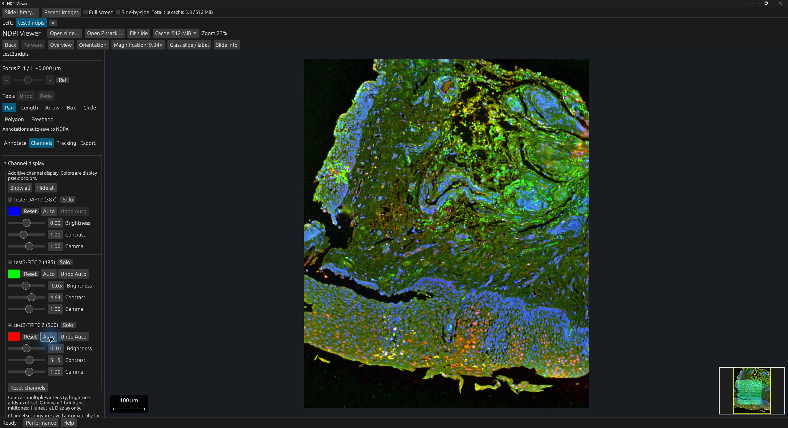
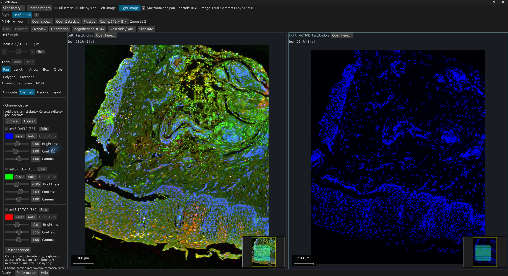

# NDPI Viewer

**Explore whole-slide images, fluorescence and Z stacks on Windows.**
Built with Rust and egui. Local files, no account, no cloud uploads.

[](https://github.com/Mancuerna/ndpiviewer-rs/actions/workflows/ci.yml)
[](https://github.com/Mancuerna/ndpiviewer-rs/releases/latest)
[](LICENSE)

**[Download for Windows x64](https://github.com/Mancuerna/ndpiviewer-rs/releases/latest)** · [What's new](CHANGELOG.md)



## Made for exploring slides

- **Navigate comfortably:** tiled zoom and pan, Z-plane controls, a corner minimap and visited-area tracking.
- **Compare side by side:** synchronized zoom and pan, with independent channel settings.
- **Tune fluorescence:** channel visibility, pseudocolors, brightness, contrast, gamma and automatic contrast.
- **Measure and annotate:** calibrated lengths and areas, editable NDPA annotations and undo/redo.
- **Export what matters:** PNG/JPEG views, native-resolution PNG regions and CSV measurements, with optional annotations and scale bars.
- **Keep memory bounded:** a shared 512 MiB tile cache by default, configurable to 96 or 256 MiB. Total process memory also includes decoding and rendering.



## Install and use

Download the latest `Windows-x64-Setup.exe` from **Releases** and run it.
No Java, Rust installation or administrator account is required. The installer is
currently **unsigned**, so Windows may show a SmartScreen warning.

Open an `.ndpi` slide or an `.ndpis` fluorescence set. Keep all files referenced by
an NDPIS set together. Scroll to zoom, drag to pan and use **Focus Z** to change planes.
Press **V** for the sidebar and **G** for the minimap. **Settings** offers interface scaling,
label thumbnails and arrow-key movement as a percentage of the visible field.
Annotations and per-image preferences are saved beside your images when writable.
**Help > Open error logs folder** opens local diagnostics; logs omit image names,
paths and annotation text and are never uploaded.
At startup, the app checks GitHub for a newer stable release and shows a dismissible
download link when available. Updates are installed manually; no slide data is sent.

Experimental software; not clinically validated. Physical measurements require
valid file calibration. Tracking uses our own sidecar format. No sample slides
are included. Independent project, not affiliated with Hamamatsu.

## Build

Install Rust (MSVC) and Visual Studio C++ Build Tools on Windows, then:

```powershell
cargo run --release --locked --bin ndpiviewer-rs
```

`./scripts/check.ps1` runs the checks. To build the installer, install Inno Setup 6
and Python 3, then run `./scripts/build-installer.ps1 -Compiler <path-to-ISCC.exe> -OutputDirectory dist`.
Windows CI also produces a downloadable installer. Commits using `feat:` and `fix:`
feed Release Please; merging its release PR builds and publishes the next version
with a changelog after checks pass.

## License and credits

Code: **[GPL-3.0-or-later](LICENSE)**. Uses [bioformats-rs](https://github.com/henriksson-lab/bioformats-rs)
(GPL-2.0-or-later) and [egui](https://github.com/emilk/egui). Dependency notices ship with the installer;
each release also includes a source archive with the locked dependencies.

Screenshots show Manuel Stritt's [public fluorescence sample](https://downloads.openmicroscopy.org/images/Hamamatsu-NDPI/manuel/),
licensed [CC BY 4.0](https://creativecommons.org/licenses/by/4.0/), with display colors and contrast adjusted in the viewer.
